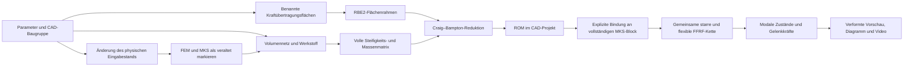

# Volumen-FEM und flexible Komponenten-ROMs

Stand: 02.11.2026. Forschungsprototyp; Prüfumfang unten.

## Aufbau

Ein FEM-Modell gehört zu einem nativen CAD/MKS-Verbund oder zu einem einzelnen
Bauteil darin. Die Anschlüsse sind **benannte, assoziative CAD-Flächen** aus
„CAD → MKS“. Punktlastanschlüsse werden für die Reduktion nicht als Flächen ersetzt.
Die erste gewählte Fläche definiert den lokalen bewegten Referenzrahmen.
Weitere Flächen behalten je drei Translationen und Rotationen.

Die Oberflächenansicht macht die Konstruktion transparent und färbt genau die
aktuell aufgelösten CAD-Flächendreiecke rot. Sie verändert keine gespeicherte
Bauteilfarbe und keine Geometrie. Eine fehlende Fläche wird nicht durch einen
roten Kreis oder eine gedachte Ersatzfläche kaschiert.

## Methodik



- Kleine, linear elastische Verformungen, isotroper Werkstoff mit E, ν und ρ.
- Dreidimensionale Tetraeder: TET4 oder vorzugsweise quadratische TET10.
  Vierpunktintegration der TET10-Steifigkeit und exakt integrierte konsistente
  Massenmatrix; die Elementgeometrie bleibt geradkantig.
- RBE2-Flächenkopplung: Flächennetzknoten folgen einem starren Schnittstellenrahmen.
  Dies überträgt Kraft und Moment arbeitskonjugiert, versteift aber die Fläche.
  Es ist keine gleichmäßige Drucklast und keine verteilende RBE3-Kopplung.
- Hurty–Craig–Bampton: statische Zwangsformen Ψ = −Kᵢᵢ⁻¹ Kᵢᵦ R sowie
  massennormierte Eigenformen bei festgehaltenen Schnittstellen.
- Die erste Fläche wird aus den elastischen Schnittstellenkoordinaten entfernt;
  ihre sechs Starrkörperfreiheitsgrade gehören in den FFRF-Referenzrahmen.
  Dadurch werden Starrkörperfreiheitsgrade nicht doppelt eingeführt.
- Kᵣ = Vᵀ K V und Mᵣ = Vᵀ M V. Gespeichert werden Netz, Basis, reduzierte
  Matrizen, Eigenfrequenzen, Anschlussknotensätze, Werkstoff, Eingabestand
  und Solverherkunft.
- Der flexible Referenzlauf verwendet das echte Exudyn-Objekt
  `ObjectFFRFreducedOrder`, einschließlich Trägheitskopplung, Gravitation,
  Flächenmarkern und Gelenkreaktionen. Er ist ein flexibler Bauteillauf mit
  vorgeschriebener Referenzbewegung, keine nachträglich auf starre Bewegung
  aufgesetzte Verformungsanimation.

## Bedienung

1. Im CAD eine ebene Fläche auswählen und unter „CAD → MKS“ als
   Kraftübertragungsfläche speichern. Mindestens zwei getrennte Flächen sind
   für einen üblichen Einspann-/Lastfall sinnvoll.
2. Im FEM-Reiter die Kraftübertragungsflächen transparent/rot prüfen.
3. „Bauteil-FEM / ROM“ öffnen, Verbund oder Bauteil und Flächenreihenfolge wählen.
4. Werkstoff, Netzunterteilungen, Eigenformen und Last einstellen. Volumen-FEM
   und ROM berechnen; die Berechnung läuft außerhalb des Fensterthreads.
5. Verformung und FE-Gitter prüfen. Der Darstellungsfaktor verändert nur das Bild.
6. Nach Geometrie-, Anschluss- oder Parameteränderungen das FEM-Modell neu
   anlegen und reduzieren. Veraltete Ergebnisse werden nicht weiterverwendet.

Unveränderte native Quader und Vollzylinder können automatisch vernetzt werden.
Bei Quadern wirken die drei Unterteilungen in X/Y/Z. Bei Zylindern gibt der
erste Wert die axialen Lagen an; der Umfang hat derzeit fest 24 Segmente mit
einem inneren Ring. Die beiden weiteren Werte verändern dieses Zylindernetz
nicht. Ein importiertes Netz verwendet seine mitgelieferte Diskretisierung.
Komplexe Bauteile oder gebundene Baugruppen benötigen ein zusammenhängendes
Volumennetz. JSON-Import in CAD-Weltkoordinaten (mm):

```json
{"nodes_mm":[[0,0,0],[10,0,0],[0,10,0],[0,0,10]],"tetrahedra":[[0,1,2,3]]}
```

Das kleine Beispiel zeigt nur das Dateiformat, kein geeignetes ROM-Referenznetz.
Ein importiertes TET4-Netz wird für die Standardberechnung zu TET10 erweitert.
Die FE-Fläche muss 95–105 % der zugehörigen CAD-Fläche abdecken. Eine Baugruppe
braucht echte, modellierte Verbindungen im Netz. Getrennte Netze werden abgelehnt;
die Software erfindet keine Klebe-, Schraub- oder Kontaktverbindungen.

## Nachweise und Grenzen

Referenz: Stahlquader 1000 × 100 × 100 mm, E = 210000 MPa, ν = 0,3,
ρ = 7850 kg/m³, 100 N Querlast, starre Endflächenkopplung.

| TET10-Knoten | Endverschiebung [mm] |
|---:|---:|
| 45 | 0,01670835 |
| 81 | 0,01814531 |
| 425 | 0,01884141 |

Euler–Bernoulli-Vergleich: 0,01904762 mm. Das feinste Netz weicht um ca. 1,08 %
ab. Die Balkentheorie ist ein Plausibilitätsvergleich, keine exakte 3D-Referenz.
Die Element- und Einspanneinflüsse müssen in einer Dissertation getrennt
untersucht werden. Grobe TET4-Netze waren deutlich zu steif; deshalb TET10 als
Standard. Masse 78,5 kg; Kräftegleichgewicht und starre Translationen geprüft.
ROM/FEM-Verschiebungsfehler beim statischen Schnittstellenlastfall < 10⁻⁶,
tatsächlich ca. 10⁻¹¹. Das beweist keine dynamische Genauigkeit für beliebige
Anregungsfrequenzen. Die Modenzahl ist dafür separat zu konvergieren.

Ein echter FFRF-Lauf mit 200 Schritten und 41 Ausgaben wurde geprüft.
Weitere Nachweise: `output/fem-rom/verification.json` und
`tools/verify_fem_rom.py`. Keine Aussage über Plastizität, Kontakt, Beulen,
Schraubenvorspannung oder große elastische Verformungen.

Ein geprüftes ROM eines vollständigen bewegten CAD-Verbunds kann mit
„In MKS flexibel verwenden“ an seinen Block gebunden werden. Der normale
MKS-Start wählt dann den gemischten Starrkörper-/FFRF-Solver. Gelenke und
Lasten müssen eindeutig auf reduzierte CAD-Flächenrahmen passen. Ein
Bauteil-ROM darf keine zusätzlichen starren Anbauteile seines Blocks auslassen.
Die FE- und CAD-Masse müssen bis auf 2 % übereinstimmen; sonst wird der Lauf
abgelehnt. Die Differenz erlaubt die polygonale Zylindervernetzung, ersetzt
aber keine Netzkonvergenzprüfung.

Die flexible Kette verwendet `MarkerSuperElementRigid`, gemeinsame
Gelenkbedingungen und echte modale Zustände. Gelenkkoordinaten und
Zwangsrestfehler werden an den **verformten Anschlussrahmen** ausgewertet.
Das FE-Oberflächennetz wird aus Basis und modalen Zuständen rekonstruiert;
MKS-Vorschau, PNG und AVI zeigen diese Verformung. Die CPU-Seite rekonstruiert
nur begrenzte FE-Netze; starre CAD-Geometrie bleibt unverändert auf der GPU.
Für flexible Ketten wird die starre Ankerkorrektur im Replay abgeschaltet,
da sie elastische Anschlussverschiebungen wieder entfernen würde.

Geprüfte lokale Solverfälle: ein flexibler Körper mit freiem bzw. getriebenem
Drehgelenk sowie eine Kette aus zwei flexiblen Körpern. Anschlussrestfehler im
Zweikörperfall < 3 × 10⁻¹⁴ m. Der Frequenzvergleich voller FEM/ROM des feineren
Referenznetzes ergab für die ersten drei eingespannten Eigenfrequenzen relative
Abweichungen von ca. 0,0033 %, 0,0097 % und 0,073 %.

Die Dämpfung ist steifigkeitsproportional mit 1 % an der ersten
festgehaltenen Schnittstelleneigenfrequenz; andere Moden haben entsprechend
andere Dämpfungsgrade. Eine gedämpfte oder angetriebene Bewegung ist kein
Energieerhaltungstest. Energieausgaben enthalten FE-Kinetik, elastische
Energie und Gravitationspotential, jedoch keine Bilanzierung der Antriebsarbeit.

Die elastischen Anfangsverschiebungen und -geschwindigkeiten sind null.
Gravitation und Lasten erzeugen deshalb Anlaufschwingungen; ein unter
Eigengewicht bereits statisch vorverformter Roboter wird noch nicht automatisch
initialisiert. Diese Anlaufanteile sind echte Ergebnisse dieses Anfangswertfalls,
keine Messung eines eingeschwungenen, vorgespannten realen Roboters.
Für entsprechende Vergleiche ist eine separate Anfangsgleichgewichtsrechnung
mit klar festgelegten Gelenkbedingungen erforderlich.

Die Dateiprüfung behandelt FEM-Daten separat: maximal 16 MiB, höchstens
64 Verschachtelungsebenen und endliche Zahlen bis 10³⁰. SI-Steifigkeiten dürfen
größer als die CAD-Koordinatengrenze sein. CAD-Felder behalten ihre bisherige
Grenze; darstellbare FEM-Knoten werden zusätzlich räumlich begrenzt.
Ein Test öffnet die native JSON-Datei mit großen Matrixwerten ausdrücklich
ohne Wiederverwendung des Modellspeichers. Ein weiterer Prüflauf öffnet eine
kopierte Projektdatei in einer frischen Programminstanz.

Spannungsauswertung: Die Von-Mises-Werte werden an den Element-
Integrationspunkten ausgewertet. Deren Maximum ist kein extrapolierter,
netzkonvergierter Spannungshöchstwert der realen Bauteiloberfläche.

## Quellen

- [Exudyn: Modellreduktion und Component Mode Synthesis](https://jgerstmayr.github.io/EXUDYN/docs/RST/ModelOrderReductionAndComponentModeSynthesis.html)
- [Exudyn: ObjectFFRFreducedOrder](https://exudyn.readthedocs.io/en/latest/docs/generated/items/ObjectFFRFreducedOrder.html)
- [Exudyn: FEM-Werkzeuge](https://exudyn.readthedocs.io/en/latest/docs/generated/pythonUtilities/FEM.html)

Lokale Numerik: NumPy, SciPy und Exudyn 1.13.6. Kein Berechnungsserver.
