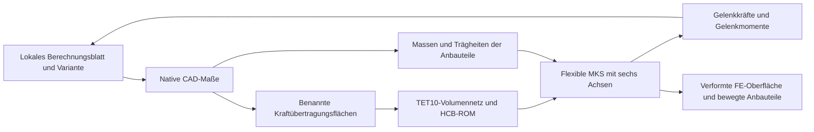

# Flexibler Roboter mit CAD-Flächenschnittstellen

## Aufbau

Die beiden hohlen Armprofile werden als elastische Volumenkörper reduziert. Jedes andere Bauteil ihres ursprünglichen CAD-Starrkörperblocks erhält eine explizite Zuordnung zu einer Anschlussfläche. Aus den CAD-Massen, Schwerpunkten und Trägheitstensoren entstehen dort starre Anbaugruppen. Die FEM-Masse enthält ausschließlich die ausgewählten elastischen Bauteile.

Die Rückführung der Ergebnisse in eine neue Auslegungsvariante erfolgt aktuell durch den Anwender. Automatische Optimierung über diese vollständige Kette steht noch aus.

## Bedienung

1. Eine Berechnungsvariante auswählen, Werte ändern und die Konstruktion aktualisieren.
2. Im CAD die tatsächlichen Kraftübertragungsflächen markieren und als benannte Schnittstellen anlegen. Für die Rohrprofile dienen die beiden ringförmigen Stirnflächen als Anschlüsse.
3. Im FEM-Reiter die Komponente und das elastische Bauteil auswählen. Die Anschlussreihenfolge beginnt am bewegten Referenzanschluss.
4. Unter „Starre Anbauteile an ROM-Flächen“ jedes übrige Bauteil einer ausgewählten Fläche zuordnen. Die Zuordnung bleibt im nativen Projekt gespeichert und bearbeitbar.
5. Unter „Gelenke an ROM-Flächen anbinden“ die jeweiligen Gelenke zuweisen. Eine ideale starre Transformation transportiert die Flächenbewegung bis zur Gelenkachse. Sie fügt keine Masse und keine eigene Nachgiebigkeit hinzu.
6. Netz und ROM berechnen und die Verwendung in der MKS aktivieren.
7. Im MKS-Reiter die wiederverwendbaren Bewegungsquellen und Gelenksensoren einstellen und die Simulation starten. Vorhandene aktuelle Ergebnisse können direkt abgespielt werden.
8. Kräfte oder lokale Momente gemeinsam im Scope anzeigen. Für die Drehachsen steht die gemeinsame Auswahl von Mz zur Verfügung.
9. Das einzelne ROM-Bauteil im FEM-Reiter öffnen, das Netz anzeigen und die dynamische Verformung untersuchen. Ein vergrößerter Darstellungsmaßstab beeinflusst die gespeicherten Rechenwerte nicht.
10. Die Bewegung über den vorhandenen Videoexport als AVI speichern.

Nach Änderungen an Geometrie, Material, Parametern oder Anschlussflächen werden die alten ROMs und Bewegungsergebnisse als historisch behandelt. Die betroffenen Modelle müssen über „Bearbeiten“ neu aufgebaut und berechnet werden.

## Numerische Modellierung

Die automatische Rohrvernetzung prüft einen nativen Zylinder und seine koaxiale Durchgangsbohrung anhand der ausgewerteten CAD-Randflächen und des Volumens. Modifizierte Geometrie mit zusätzlichen Bohrungen oder Ausschnitten benötigt ein konformes importiertes Volumennetz.

Der Ringquerschnitt wird mit 24 Umfangssegmenten diskretisiert. TET10 verwendet quadratische Verschiebungsansätze bei linearer Geometrie. Das Innere bleibt hohl. Diese endliche Diskretisierung benötigt eine Netzkonvergenzuntersuchung für belastbare Auslegungsentscheidungen.

Jedes Profil des gespeicherten Beispiels besitzt 1.296 FE-Knoten und 3.888 Verschiebungsfreiheitsgrade. Die Reduktion verwendet zwei RBE2-Flächen und sechs feste Schnittstellenmoden. Nach Abzug des Referenzanschlusses verbleiben zwölf reduzierte elastische Koordinaten pro Profil.

| Profil | FE-Masse in kg | Volle Freiheitsgrade | Reduzierte Freiheitsgrade |
|---|---:|---:|---:|
| Oberarm | 6,567924 | 3.888 | 12 |
| Unterarm | 3,406125 | 3.888 | 12 |

Vor dem flexiblen Lauf werden vollständige CAD-Körperabdeckung und Massenbilanz geprüft. Jeder CAD-Körper muss genau einmal als elastischer Eigentümer oder starres Anbauteil vorkommen. Der Solver vergleicht die FE-Masse mit der Masse der elastischen CAD-Auswahl. Die zulässige Abweichung beträgt derzeit zwei Prozent. Die polygonale Querschnittsdiskretisierung trägt zu dieser Abweichung bei.

Anbauteile werden mit ihrem Schwerpunktträgheitstensor und dem Steinerschen Satz zusammengefasst. Sie sind über sechs kinematische Bindungen an die tatsächliche reduzierte Fläche gekoppelt. Ihre Schwerpunktbewegungen und Orientierungen werden separat gespeichert und im CAD-Ergebnis abgespielt. Die Energiebilanz umfasst diese starren Anbaugruppen zusätzlich zur FE-Trägheit und elastischen Energie.

Versetzte Gelenke erhalten einen masselosen, vollständig gebundenen Kopplungsrahmen. Dadurch folgt der Hebelarm der Flächenrotation. Der Rahmen repräsentiert eine ideale starre Anschlussannahme. Die reale Auslegung dieses Anschlusses muss dessen Geometrie und Steifigkeit nachweisen.

Die vorhandenen Grenzen von acht beweglichen CAD-Blöcken und 1.001 Ausgabepunkten bleiben erhalten. Flexible lokale Rechnungen erhalten eine Prozessgrenze von 180 Sekunden. Für die kleinen reduzierten Matrizen wird standardmäßig ein BLAS-Rechenfaden im Solverprozess verwendet. Explizite Umgebungswerte des Anwenders haben Vorrang.

## Annahmen und offene Fertigungsauslegung

- Das Beispiel verwendet lineare isotrope Elastizität, kleine elastische Verformungen und starre RBE2-Anschlussflächen.
- Das Ausgangsmodell enthält weiterhin vereinfachte Antriebsgehäuse, Verkleidungs- und Kabelkörper. Sie sind in diesem Beispiel am jeweiligen Rohrwurzelanschluss starr angeordnet. Ihre geometrische Darstellung und Steifigkeitswirkung benötigen eine mechanische Überarbeitung.
- Ohne die optionale statische Vorspannung beginnt die Bewegung mit verschwindenden elastischen Koordinaten und Geschwindigkeiten. Eigengewicht regt deshalb Einschwingvorgänge an. Die wählbare Option "Statisch vorspannen" ergänzt einen statischen Startzustand. Die Vergleichsrechnung ist im Bericht ROBOTER_STATISCHE_VORSPANNUNG.md dokumentiert.
- Schrauben-, Lager- und Getriebenachgiebigkeit, Reibung, Greifkontakt und Materialplastizität sind separat zu entwickeln.
- Die Panasonic-Motordarstellung bildet eine katalogbasierte Montagehülle mit kalibrierter Masse ab. Andere Antriebe und die vollständige Getriebe- und Lagerauswahl bleiben in Ausarbeitung.
- Tragende Achsanschlüsse, Passungen, Kollisionsfreiheit, Ermüdung, Sicherheitsfunktionen und vollständige Fertigungszeichnungen sind noch offen. Die gesamte Roboterbaugruppe besitzt keine Fertigungsfreigabe.

## Methodische Quellen

Die Oberflächenmarker und ihre Starrkörperrotation folgen der dokumentierten Exudyn-Schnittstelle. [MarkerSuperElementRigid](https://exudyn.readthedocs.io/en/v1.13.6/docs/generated/items/MarkerSuperElementRigid.html)

Die masselosen Kopplungsrahmen nutzen den dokumentierten Starrkörper mit nichtnegativer Masse und sechs gebundenen Gelenkkoordinaten. [ObjectRigidBody](https://exudyn.readthedocs.io/en/v1.13.6/docs/generated/items/ObjectRigidBody.html), [ObjectJointGeneric](https://exudyn.readthedocs.io/en/v1.13.6/docs/generated/items/ObjectJointGeneric.html)

Katalogannahmen und die vorläufige Antriebsauslegung stehen im zugehörigen Bericht „MKS-Gelenkmomente und A2-Antrieb“.

## Ergänzung vom 06.11.2026

Der MKS-Reiter bietet den optionalen statisch vorgespannten Start. Eine explizite Bewegung muss dabei jedes bewegliche Gelenk halten. Neue Auswertungen und Grenzen stehen im Bericht ROBOTER_STATISCHE_VORSPANNUNG.md.
