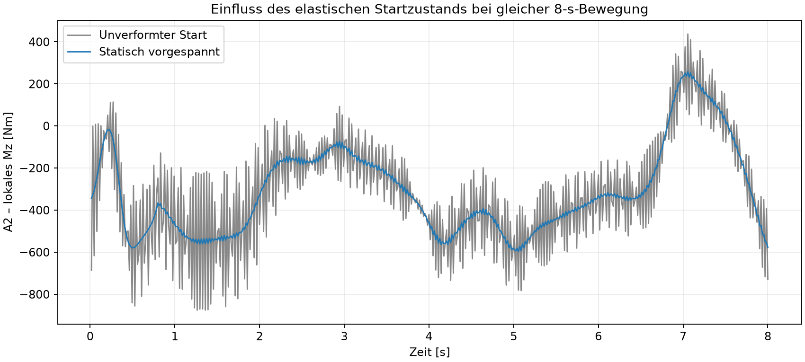

# Statisch vorgespannter Start für flexible Robotermodelle

## Bedienung und gespeicherter Zustand

Im MKS-Reiter steht neben der Schwerkraft die Option **Statisch vorspannen**. Sie wird im Projekt gespeichert. Bestehende Projekte behalten ihren bisherigen unverformten Start, solange die Option ausgeschaltet bleibt.

Die Vorspannung setzt aktive ROM-Körper und eine vorgeschriebene Bewegung an jedem beweglichen Gelenk voraus. Zunächst hält der Solver alle Gelenke an ihren CAD-Ausgangskoordinaten. Eigengewicht und vorhandene konstante Anschlusslasten werden in acht Lastschritten aufgebracht. Nach erfolgreichem statischem Gleichgewicht übernimmt die Zeitintegration die elastischen Anfangskoordinaten und beginnt mit verschwindender Anfangsgeschwindigkeit. Nicht konvergierte Startzustände werden abgelehnt.

Die wiederverwendbaren Bewegungsquellen liefern für Kosinus-, Quintik- und Sinusprofile sowohl die Position als auch deren analytische Zeitableitung. Dieselbe Implementierung wird von den lokalen Starrkörper-, Einzel-ROM- und flexiblen Baugruppen-Solvern verwendet.

Das native Beispiel **Roboter 8 kg – statisch vorgespannte ROMs** enthält ein aktuelles gespeichertes Ergebnis. Die normale Wiedergabe benötigt keine neue Solverrechnung. Nach einer physikalischen Modelländerung müssen die betroffenen ROMs und die MKS neu berechnet werden.

## Vergleich bei identischem Modell und identischer Bewegung

Die Paarrechnung verwendet dieselbe aktuelle Solverimplementierung und identische Bewegungsquellen. Geändert ist ausschließlich die Option für den statischen Anfangszustand. Zwei Hohlprofil-ROMs, sechs vorgeschriebene Gelenkbewegungen, acht Sekunden, 4.000 Integrationsschritte und 501 Ausgabepunkte. Für die Auswertung der dynamischen Reaktionen wird die erste Stichprobe weiterhin ausgeblendet. Die RMS-Auswertung integriert die verbleibenden Stichproben zeitgewichtet.

| A2-Auswertung | Unverformter Start | Statisch vorgespannter Start |
|---|---:|---:|
| Spitzenbetrag lokales Mz | 875,481 Nm | 597,267 Nm |
| RMS lokales Mz | 403,646 Nm | 373,040 Nm |

| Elastische Knotenverschiebung | Anfang | Maximum der Bewegung |
|---|---:|---:|
| Oberarm | 0,08147 mm | 0,13936 mm |
| Unterarm | 0,04787 mm | 0,07588 mm |

Die motorseitige Überschlagsrechnung mit angenommener Übersetzung 120, Wirkungsgrad 0,75 und Faktor 1,5 ergibt 6,217 Nm RMS sowie 9,954 Nm Spitzenbedarf. Der katalogbasierte Kandidat MSMF202L1H8 besitzt 6,37 Nm Nennmoment. Die geringe RMS-Reserve erfordert die weitere Prüfung von Lastzyklus, Thermik, Spitzenmoment, Getriebe und Lagerung.

Die native Solverrechnung benötigte in diesem Lauf 71,18 Sekunden. Davon entfielen 68,84 Sekunden auf die Zeitintegration und 0,067 Sekunden auf die statische Initialisierung. Das sind Messwerte dieses Laufs auf diesem Rechner. Eine Beschleunigung gegenüber früheren Läufen ist daraus nicht isoliert ableitbar.

## Vorzeichen und Nachvollziehbarkeit

Die Ergebnisdatei speichert die statischen Initialisierungsreaktionen und die dynamischen Zeitreihen getrennt als rohe lokale Exudyn-Ausgaben. Im beobachteten Lauf besitzen die statischen Reaktionen und die erste dynamische Reaktion entgegengesetzte Vorzeichen. Eine gemeinsame signierte Darstellung dieser beiden Solverphasen benötigt eine geklärte Konvention. Die hier verglichenen dynamischen Beträge und RMS-Werte verwenden ausschließlich die dynamischen Zeitreihen.

Die Nachweisdaten enthalten Recheneinstellungen, Solver- und Bewegungsquellen-Hashes, Phasenlaufzeiten, Initialisierung und Gelenkzeitreihen. Die Grafik stellt ausschließlich den Einfluss des Startzustands bei unveränderter Geometrie dar. Nachfolgende Änderungen an der Schultergabel gehören zu einem eigenen Modellstand.

## Verifikationsumfang und offene Auslegung

Anwendung und Kommandozeilenwerkzeug wurden gebaut. Die normale FEM-ROM-MKS-Kette wurde über native Befehle berechnet und das gespeicherte Ergebnis in einer eigenen Programm-Instanz als aktuell erkannt und abgespielt. Der native Videoexport erzeugte 241 Bilder bei 30 FPS. Listenprüfung und Diff-Prüfung wurden ausgeführt. Breite automatisierte Tests und vollständige CI bleiben auf Benutzerwunsch pausiert.

Netz-, Moden- und Zeitschrittkonvergenz sowie Kontakt-, Schrauben-, Lager- und Getriebenachgiebigkeit stehen aus. Die Gesamtbaugruppe benötigt weiterhin die vollständige mechanische Auslegung und Fertigungsfreigabe.

## Methodische Quellen

Die Schnittstelle beschreibt vorgegebene Gelenkoffsets und deren Zeitableitung. [Exudyn ObjectJointGeneric](https://exudyn.readthedocs.io/en/v1.13.6/docs/generated/items/ObjectJointGeneric.html)

Die statische Lösung kann ihre Koordinaten als Anfangszustand der nachfolgenden Simulation übernehmen. [Exudyn MainSystem](https://exudyn.readthedocs.io/en/latest/docs/generated/cInterface/MainSystem.html)
